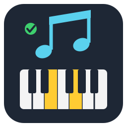
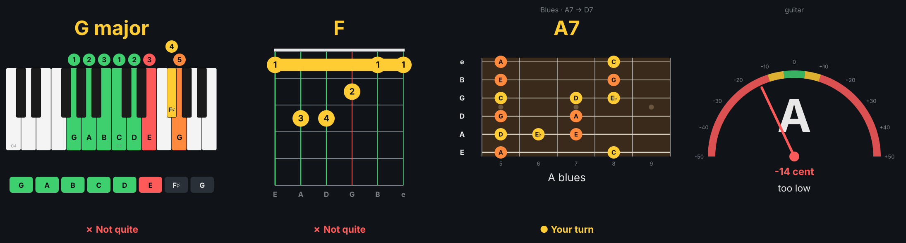

#  Music Teacher

Piano, guitar and bass lessons from your voice assistant. It shows you on
the screen what to play, with which fingers, plays it for you - and then it
listens to you play it, and tells you what was right, or the first thing
that wasn't.



```
"teach me the C major scale on piano"   the keys and the fingers, played for you -
                                        "Now you. I'm listening." - "Almost. Note 7
                                        should be F sharp - I heard F."
"how do I play A minor on guitar"       the chord chart, finger by finger; strum it,
                                        and it says which string didn't ring
"teach me Ode to Joy on piano"          a song, two bars at a time - then the whole
                                        song with the band
"teach me to jam a blues in A on guitar"  the scale to jam with, on your instrument;
                                        the band plays four bars, you play four,
                                        and it says how it went
"tune my guitar"                        string by string, with a needle
"music lesson" / "next lesson"          the course for your instrument, a lesson at a
                                        time - it remembers where you are
"what can you teach me?"

"lær mig c-dur-skalaen på klaver"       (Danish)
"hvordan tager jeg a-mol på guitar", "stem min bas", "næste lektion"
```

While a lesson is on: "again" (or "ready"), "play it", "slower", "next",
"enough".

It was made for [Emkay](https://github.com/emkay-voice/emkay), and works on
any OpenVoiceOS with a screen (or without one: everything is also said).

[](https://github.com/emkay-voice/ovos-skill-music-teacher/actions/workflows/publish.yml)
[](https://pypi.org/project/ovos-skill-music-teacher/)

## What it teaches

**Scales** - major, minor, harmonic minor, dorian, mixolydian, major and minor
pentatonic, blues - in every key, spelled the way a teacher writes them (F
major has a B flat, not an A sharp). On the piano with the usual right-hand
fingering, on guitar and bass in one position, one finger per fret, with open
strings low on the neck.

**Chords** - major, minor, 7, maj7, m7, dim, sus2, sus4, 6. On the guitar the
open chords from every chord chart, and barre chords (E and A shapes) for the
rest, said finger by finger: "ring finger on the A string, fret 3, middle
finger on the D string, fret 2 and index finger on the B string, fret 1.
Don't play the low E string." On the piano with the fingers (1-3-5), on the
bass as an arpeggio, a note at a time.

**Songs** - the tunes that come with
[ovos-skill-jamband](https://github.com/emkay-voice/ovos-skill-jamband):
folk songs, nursery rhymes and old classics, all free to use (Ode to Joy,
Frère Jacques, When the Saints, Twinkle Twinkle, Für Elise ...), found by
their name in any language.

- piano: the melody, two bars at a time;
- guitar: the chords the song uses, one by one, then you strum along with the
  band (the course moves the songs to G or D, where the chords are easy);
  "the melody" gets you the tune instead;
- bass: the bass line - the root of each bar's chord.

When you have every piece, you play the whole song with the band, twice
round, the screen showing what comes in each bar.

**Jamming** - the band (ovos-skill-jamband's) plays a style in a key: blues,
rock, pop, funk, swing, disco, reggae, bossa or tango. You get the scale that
fits, lit on your instrument, with the notes of the chord being played
brighter: the notes that always sound good. Then you take turns - four bars
the band (someone takes a solo, to give you ideas), four bars you. After your
turn the teacher says a word: how many of your notes were in the scale, and
whether you landed on a note of the chord. That is how you learn to jam on
piano, guitar and bass - and learn the scales on the way.

**Tuning** - guitar or bass, string by string from the lowest: "A bit low -
tighten it a little." The screen has a needle, in cents.

**The course** - for each instrument, about twenty lessons that build on each
other: a scale, the chords you need, a song with those chords, a jam with the
scale... "music lesson" starts the next one; it remembers how far you got.
The courses are in `lessons/`, as plain JSON - easy to add to.

## How it hears you

Through the microphone, as ovos-skill-jamband hears a hummed melody: the
listener's recording mode (`recognizer_loop:state.set` "recording", as
ovos-dinkum-listener has it; Emkay does the same). Then:

- **notes one after another** (a scale, a piece of a song, a bass line): the
  pitch is followed (YIN, down to a bass's low E) and cut into notes, and
  compared with what you were asked to play. Noise before or after doesn't
  count against you; a microphone can't always tell octaves apart, so the
  note names are compared.
- **a chord**: how strong each of the twelve notes sounds while it rings
  (with the overtones of a string turned down). Every note of the chord must
  be there, and no wrong one. On the guitar a missing note is traced back to
  its string: "I didn't hear the C - check the B string, fret 1."
- **a string, for tuning**: its steady pitch, in cents from where it should be.

With a **MIDI keyboard** plugged in, the keys pressed come from
[ovos-phal-plugin-midi](https://github.com/emkay-voice/ovos-phal-plugin-midi)
(`ovos.midi.input`, also Web MIDI in Emkay) and count exactly - every key,
every octave. The plugin also plays the examples and the band.

Hearing a real instrument in a real room is never perfect. What it listens
for is kept simple on purpose (the notes asked for, the notes of the chord),
and the thresholds are in `hearing.py`. Reports from real pianos and guitars
are very welcome.

## Languages

English, Danish, German, Spanish, French, Italian, Dutch, Portuguese
(Portugal and Brazil), Catalan, Basque and Galician - every language Emkay
speaks. Notes are named the way each language does: C D E (English, Dutch),
H and B in Danish and German ("cis", "es"), do re mi in the Romance languages
and Basque - on the screen, when it speaks and when you ask ("a-mol", "la
menor", "B flat seven"). Corrections from native speakers - and from music
teachers - are very welcome.

## Install

```bash
pip install ovos-skill-music-teacher
```

It brings ovos-skill-jamband (the band, the songs) and ovos-phal-plugin-midi
(the sound). The plugin runs in OVOS' PHAL service, so restart OpenVoiceOS
once after installing; Emkay starts it by itself. Without it everything still
works - except you hear no examples, and there is no band.

## Development

See [DEVELOPMENT.md](DEVELOPMENT.md).

## Category
**Education**

## Tags
#music #learning #piano #guitar #bass #tuner #scales #chords #jam #midi
